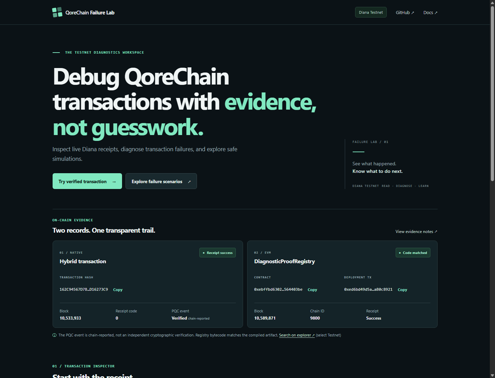
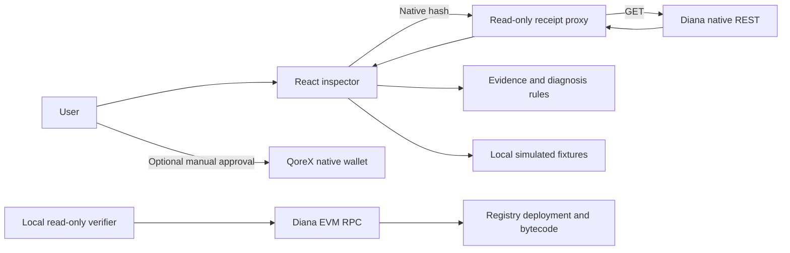

# QoreChain Failure Lab

**Inspect Diana testnet receipts with evidence, not guesswork.**

A read-only native transaction inspector, a clearly labeled failure simulation lab, and an optional QoreX signing test. Built from the official `create-qorechain-dapp` 0.14.0 fullstack-web starter.

[**Live demo**](https://qorechain-failure-lab.vercel.app/) · [Source code](https://github.com/zzzyyyddd/qorechain-failure-lab) · [Three-minute judge guide](JUDGE_GUIDE.md) · [Evidence](EVIDENCE.md)



<sub>Production UI captured on 23 November 2026. The screenshot shows the initial page; the lookup is interactive in the live demo.</sub>

## Why this exists

A missing receipt, a wallet rejection, and a committed transaction failure are different events. Treating all three as an on-chain failure can send a developer in the wrong direction. Failure Lab shows what the available evidence supports, where it came from, and what remains unknown.

- **Inspect a native receipt:** enter a 64-character native hash without `0x`, or use the verified example. See a diagnosis, evidence details, a copyable report, and the raw response.
- **Practice safely:** eight local fixtures demonstrate outcomes including out-of-gas, an unavailable endpoint, and insufficient evidence. They are explicitly simulated and make no network request.
- **Examine two separate records:** a native transaction receipt and an EVM registry deployment, each with its own identifier and verification path.
- **Test QoreX separately:** the optional wallet panel requires manual connection and a separate send action; QoreX approval is required for the testnet self-transfer.

## How it works



The inspector accepts native Cosmos transaction hashes, **not EVM transaction hashes**. In production, Vercel rewrites `/lcd/cosmos/tx/v1beta1/txs/:hash` to a GET-only function with a fixed upstream host, hash validation, a timeout and a response-size limit. Vite provides a development/preview proxy to the same REST service. The EVM verifier is a separate command; the inspector does not submit to the registry.

### Reading a diagnosis

The native and EVM-wrapper distinction has been checked against real receipts; see [real failure validation](EVIDENCE.md#real-failure-validation--2026-11-23).

1. The client validates the native hash and requests the receipt through the proxy.
2. A **matching hash, positive committed height, and numeric code** are required for a receipt-confirmed outcome. A nonzero native code is a committed native failure. Code `0` reports native success, but an EVM wrapper can still contain a failed EVM execution: the inspector flags a reported failure event, or leaves the EVM outcome unverified. Only specific codespace-and-code pairs receive a narrower native classification.
3. Invalid input, endpoint not found, transport failure and insufficient evidence are reported separately. An unavailable endpoint or absent receipt is not proof of an on-chain failure. A mismatched response is excluded from the evidence summary and report; the raw response is labeled unverified.
4. The technical report excludes raw signature fields, but can include public transaction details and raw log text. Review it before sharing. The raw receipt can contain public signature material.

## Two verified testnet records

| Record | Identifier and observation | Verification boundary |
| --- | --- | --- |
| Native Diana transaction | `162C94567D7BE3CA25150867FA2477E849591F149BC8E8739F57A6ECD16273C9` · height `10533933` · code `0` | Native REST reports a `pqc_hybrid_verify` event as verified. That is a chain-reported event, not independent cryptographic verification. |
| EVM registry deployment | Contract `0xebffbd63020757ffdd4ca40c2ddcc3ae564403be` · deployment `0xed6bd49d5ac1a6e075d138aa0c4b8960121bee32604996fdb115e377a80c8921` · block `10589871` · chain `9800` | Read-only RPC checks found a successful creation receipt and matching locally compiled creation and runtime bytecode. RPC responses are not consensus proofs. |

These are separate transactions on separate interfaces. [Evidence and the 12-hash native sample](EVIDENCE.md) include dates and reproducible details.

### What the registry proves

[`DiagnosticProofRegistry`](contracts/DiagnosticProofRegistry.sol) records a caller-supplied, nonzero `bytes32` commitment and emits `DiagnosticRecorded`. A caller cannot record the same hash twice; a different caller can. A record establishes that an address recorded a hash, **not** that a report is true or confidential. Hashes, caller addresses and timing are public; a hash is not encryption. The application does not automatically create or record commitments.

## Three-minute walkthrough

1. **0:00–0:45:** Open the [live demo](https://qorechain-failure-lab.vercel.app/) and choose **Try verified transaction**. Inspect the confirmed receipt, evidence details and report.
2. **0:45–1:30:** Paste an unfamiliar native hash from the [sample](EVIDENCE.md#unfamiliar-native-transaction-audit--2026-11-23). Compare its hash, height and code with the native REST endpoint. Network errors and missing receipts do not establish failure.
3. **1:30–2:15:** Explore simulated out-of-gas and RPC timeout. Notice the simulation label and the difference between a committed code and a transport error.
4. **2:15–3:00:** Compare the native and EVM evidence cards. Open the optional wallet panel without connecting or sending; use the [judge guide](JUDGE_GUIDE.md) to independently verify the registry afterward.

No funded wallet is needed for the walkthrough.

## Run and verify

Requires Node.js `^20`, `^22`, or `>=24` as specified in [package.json](package.json), npm, and network access for live endpoints. No API keys are needed.

```sh
npm ci
npm run dev -- --host 127.0.0.1
```

Open the URL printed by Vite, normally `http://127.0.0.1:5173/`. For another hosting provider, configure an equivalent native receipt proxy.

```sh
npm test                   # application and contract tests
npm run typecheck
npm run build
npm audit                  # full dependency tree
npm run compile:registry   # creates ignored deployment/registry-artifact.json
npm run verify:registry -- 0xed6bd49d5ac1a6e075d138aa0c4b8960121bee32604996fdb115e377a80c8921
```

The verifier performs read-only EVM RPC calls, compiles the local contract and checks chain ID, receipt, creation input and runtime bytecode. It requires endpoint access, but no wallet or transaction. The compiler uses locked `solc` 0.8.39, optimizer 200 runs and EVM Paris. See [deployment and reproduction details](DEPLOYMENT.md).

## Wallet and trust boundaries

The QoreX panel is separate from inspection. Connecting requests wallet access; sending requires an explicit click and wallet approval. The optional test sends **1 uqor to the connected native address**, plus the wallet-displayed fee; QoreX may request a separate key-registration approval. Never enter a private key or recovery phrase into this project. No wallet is needed for lookup or simulations.

The application trusts the configured REST endpoint and proxy for receipt data; it does not validate a consensus proof or independently verify a PQC signature. A chain event and a wallet-reported shield are observations from those sources, not independent verification. The classifier covers a limited set of codes and cannot explain every rejection, especially one occurring before inclusion. Fields may be absent for some messages. One genuine native committed failure was checked against the inspector; broader failure categories remain unverified against real receipts. The inspector does not query EVM receipts. Tests use fixtures and wallet stubs and do not substitute for a current real-wallet test.

## Technology and documentation

React, TypeScript and Vite power the interface; a Vercel serverless function proxies native REST reads. The registry uses Solidity; tests use Vitest, Testing Library, Node's test runner and an in-memory Ethereum VM. Compilation uses solc and verification uses ethers-compatible EVM RPC data.

| Document | Purpose |
| --- | --- |
| [Judge guide](JUDGE_GUIDE.md) | Production-first walkthrough and independent checks |
| [Evidence](EVIDENCE.md) | Native and EVM records, sample and provenance |
| [Deployment](DEPLOYMENT.md) | Registry compilation and read-only verification |
| [Audit](AUDIT.md) | Current status and historical review |
| [Dependency security](DEPENDENCY_SECURITY.md) | Historical advisories and remediation |
| [AI usage](AI_USAGE.md) | Development assistance and its limits |

Official references: [QoreChain testnet](https://docs.qorechain.io/getting-started/connecting-to-testnet/), [QoreX integrations](https://docs.qorechain.io/developer-tools/qorex-integrations/), [EVM development](https://docs.qorechain.io/developer-guide/evm-development/), [QoreChain SDK and starter](https://github.com/qorechain/qorechain-sdk), and [explorer](https://explore.qore.network/) (select Testnet).

Licensed under the [MIT License](LICENSE).
